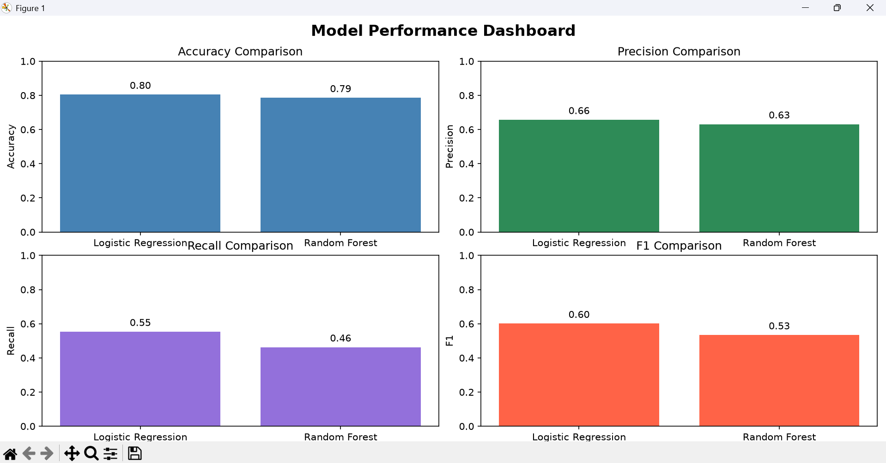
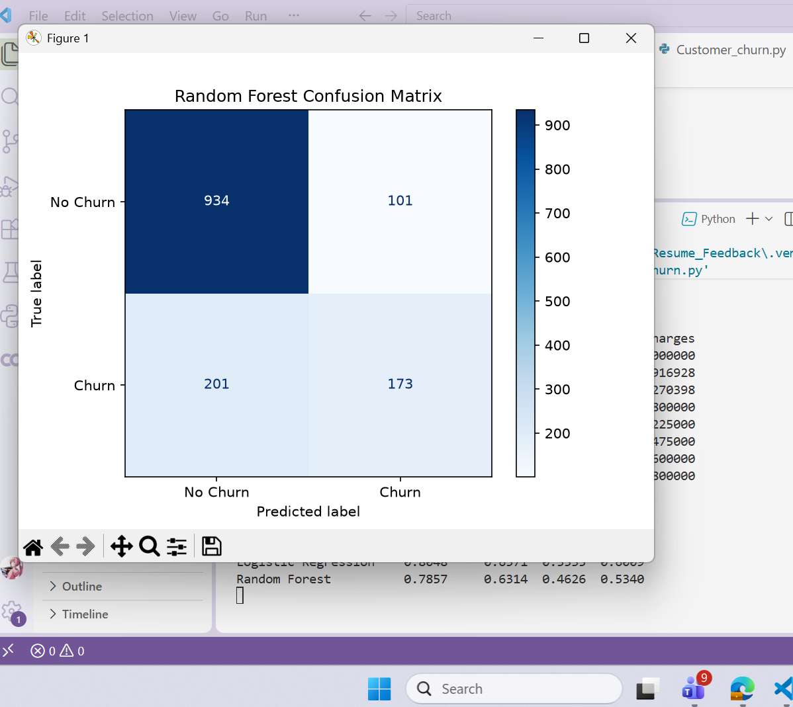
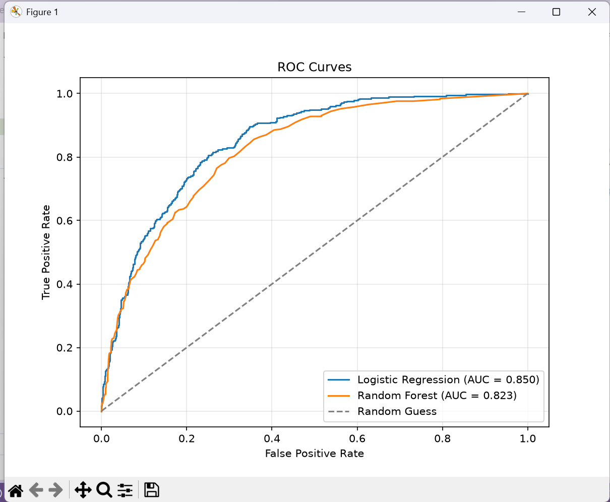
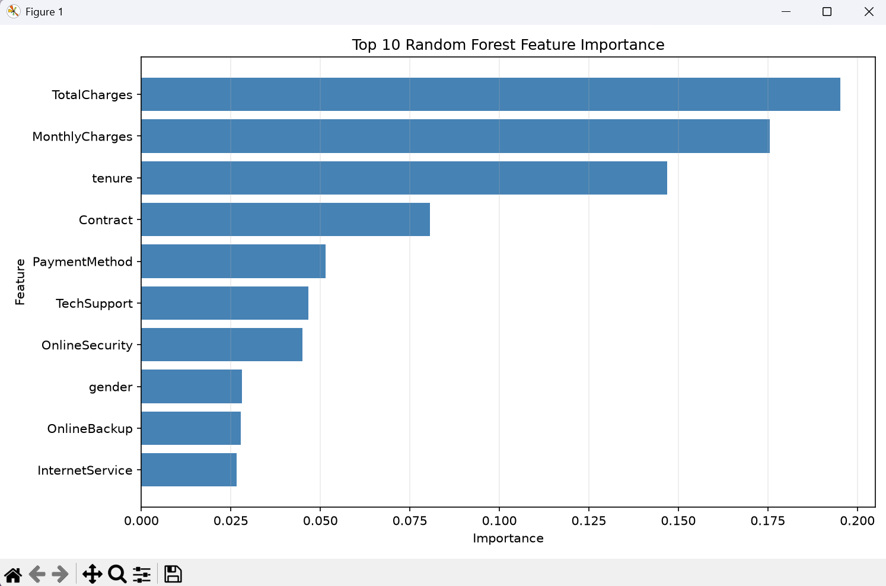

# Client-Churn-Analysis
Exploratory analysis and visualization of customer churn using Python, pandas, seaborn, matplotlib, and scikit-learn.
## Features
- Analyzed customer data to identify patterns associated with churn.
- Cleaned the dataset, including handling missing or non-numeric TotalCharges values.
- Visualized churn distribution, customer tenure, contract types, and monthly charges.
- Trained and compared Logistic Regression and Random Forest models.
- Evaluated model performance using accuracy, precision, recall, F1 score, a confusion matrix, and ROC/AUC curves.
- Highlighted the Random Forest model’s top 10 features.

 

 

 

 

 

## Tools Used
- Python — core programming language.
- pandas — loading and manipulating the CSV data.
- Matplotlib and Seaborn — charts and visualizations.
- scikit-learn — data preprocessing, train/test splitting, Logistic Regression and Random Forest models, and evaluation metrics.
- Python standard library pathlib — locating the dataset file.
