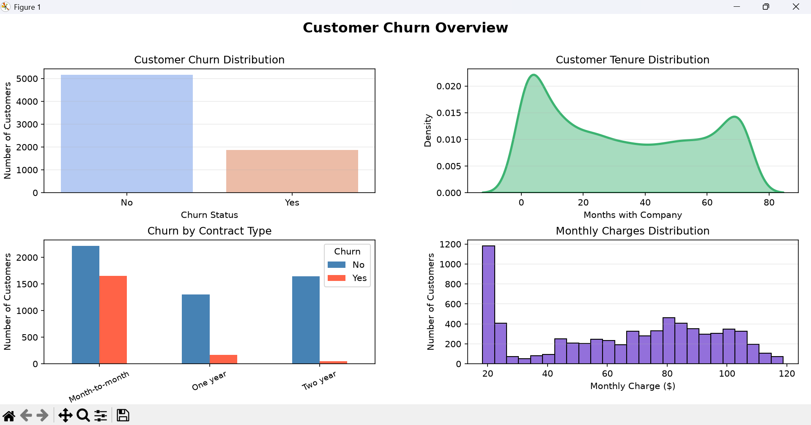

# Client-Churn-Analysis
Exploratory analysis and visualization of customer churn using Python, pandas, seaborn, matplotlib, and scikit-learn.
 
"Key Findings"
Month-Month contracts have the highest churn
one-year and two-year contracts barely churn
most customers who leave are new, with short tenure.
## Tools Used
Python, Pandas, NumPy, Matplotlib, Seaborn and Scikit-learn.
